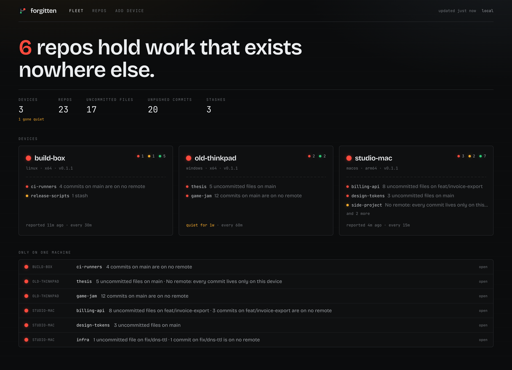

# forgitten

Find the work you forgot to push, on every machine you own.



`forgitten` is two things. A CLI scans directories for git repositories and
tells you what has not left the machine: uncommitted files, commits no remote
has, stashes. A hub collects those scans from every device you add to it and
shows them on one page.

## What it looks for

Per repository, in every checkout and linked worktree:

- files that are staged, modified, untracked, or in conflict
- commits on any local branch that no remote branch holds, with or without an
  upstream set
- branches that are ahead of or behind their upstream, or whose upstream was
  deleted
- stashes
- repositories with no remote at all

It only reads. It never fetches, so "behind" means behind what the last fetch
saw. A scan takes no git locks, so it is safe to run while you work.

## Install the CLI

**macOS / Linux:**
```sh
curl -fsSL https://raw.githubusercontent.com/orchard-suite/forgitten/main/install.sh | bash
```

**Windows (PowerShell):**
```powershell
irm https://raw.githubusercontent.com/orchard-suite/forgitten/main/install.ps1 | iex
```

Both scripts download the binary for your platform from the latest GitHub
release and check it against the release's `SHA256SUMS` before installing it.
Set `VERSION` (or `-Version` on Windows) to install a specific release.

**Uninstall:**
```sh
# macOS / Linux
curl -fsSL https://raw.githubusercontent.com/orchard-suite/forgitten/main/install.sh | bash -s -- --uninstall

# Windows
& ([scriptblock]::Create((irm https://raw.githubusercontent.com/orchard-suite/forgitten/main/install.ps1))) -Uninstall
```

It needs `git` on the path.

## Scan this machine

```sh
forgitten [path...] [options]

Arguments:
  <path>  Directories to scan (default: current directory)

Options:
  --json             Output the full report as JSON
  --dirty            Show only repos with uncommitted changes
  --unsynced         Show only repos with unsynced branches
  --ignore <pattern> Glob patterns to skip (repeatable)
  --no-color         Disable colored output
  -q, --quiet        Summary line only
  --help             Show help
```

```sh
# Scan the current directory
forgitten

# Scan two trees, show only repos with uncommitted changes
forgitten ~/source /srv/work --dirty

# JSON for scripting
forgitten --json | jq '.summary'

# Skip directories by name
forgitten --ignore archive --ignore .venv
```

`node_modules` is always skipped. A linked worktree is reported under its
repository, wherever it lives.

Exit codes:

- `0` - every repo is clean
- `1` - some repos have uncommitted or unsynced work, or could not be read
- `2` - error (invalid path, git not found)

## Report to a hub

```sh
# Sign in, add this device, and report every 15 minutes from now on.
# The hub's Add device page shows this line filled in.
forgitten fleet join https://forgitten.example.org --tenant <tenant-id> --client <client-id> --path ~/source
```

`join` prints a code. Enter it at the Microsoft sign-in page, on any device.
The first report is sent at once, and the operating system's scheduler sends
one every 15 minutes after that. `--interval` changes the timing; `--no-agent`
skips the schedule, so the device reports only when you run `fleet report`.
Repeat `--path` for every directory to scan; later, `forgitten fleet paths add
~/more` adds one without a new sign-in.

On macOS the schedule is a system launchd daemon that runs as you, so
installing it asks for your password once. A per-user agent would be kept off
the local network by macOS, and a hub on your home network would never hear
from the device.

| Command | What it does |
| --- | --- |
| `fleet join <hub> --tenant --client --path` | Sign in, add this device, send a first report, and install the schedule. `--path` and `--ignore` repeat. `--name` sets the name it shows under. `--interval` sets the minutes between reports; `--no-agent` skips the schedule. Run it again to change the directories or to sign in again |
| `fleet report` | Scan and send one report |
| `fleet paths list`, `paths add <dir>...`, `paths remove <dir>...` | Change the scanned directories without signing in again. A report is sent at once |
| `fleet status` | Show the hub, the directories, and the schedule |
| `fleet agent install [--interval 15]` | Install or change the schedule: a launchd daemon on macOS, a systemd user timer on Linux, Task Scheduler on Windows |
| `fleet agent uninstall` | Stop the schedule |
| `fleet leave` | Remove this device from the fleet, the schedule, and the stored sign-in |

The hub and the sign-in host must use https; plain http is allowed only to
`localhost`, for trying it out.

The device keeps a refresh token in its config directory
(`~/.config/forgitten`, or `%APPDATA%\forgitten`), readable only by you.
Remote URLs are sent without any user name or token in them.

## The hub

One page for the fleet: which devices hold work that exists nowhere else, what
it is, and which devices have gone quiet.

- **Red** is work that is gone if the device is: uncommitted files, commits no
  remote has.
- **Amber** is worth a look: stashes, a repository with no remote, a
  repository git could not read, a device that stopped reporting.
- **Green** is pushed.

A repository can be muted on a device; it stays listed and stops colouring the
device. The Repos page shows each repository once with every device that has
a clone of it.

The board is shared. Everyone who can sign in to a hub sees every device on
it and can rename, mute, or remove any of them. Only the account that added a
device can report as it.

### Sign-in

Everything needs a completed Microsoft Entra sign-in. There are two doors and
one app registration behind both:

- **The browser** reaches the web app and its API through a login proxy
  (oauth2-proxy). The hub trusts the identity headers that proxy sets, so the
  session port must be reachable by the proxy and by nothing else.
- **A device** sends an Entra access token for the `Fleet.Report` scope. The
  hub checks its signature, issuer, tenant, audience, and scope itself. Only
  the account that added a device can report as it.

`scripts/entra-app.sh <public-url> [key-vault]` creates the app registration
with the Azure CLI: the redirect URI for the proxy, the device code flow, the
scope, version 2 tokens, and assignment required.

### Run it

```bash
npm install
npm run dev        # hub on :8080 and :8081 with no login, web on :5173
```

To try the device flow without a tenant, `node scripts/fake-entra.ts` starts a
stand-in for Entra and prints the settings for the hub and the CLI.

To see the board without any devices, `npm run build && node scripts/demo-fleet.ts`
runs a hub on :8080 with three made-up devices. The screenshot above comes from it.

Configuration is by environment variable:

| Variable | Default | Meaning |
| --- | --- | --- |
| `PORT`, `HOST` | `8080`, `0.0.0.0` | The session surface: web app and API, for the login proxy only |
| `INGEST_PORT`, `INGEST_HOST` | `8081`, `0.0.0.0` | The device surface: `/ingest/*` for the CLI, `/healthz` for probes |
| `DATA_DIR` | `./data` | SQLite database |
| `PUBLIC_URL` | `http://localhost:8080` | URL browsers and devices reach the hub on. Devices call `PUBLIC_URL/ingest/...` |
| `AUTH_MODE` | `proxy` | `proxy` trusts the login proxy's identity headers. `none` has no login and is for your own machine |
| `ENTRA_TENANT_ID`, `ENTRA_CLIENT_ID` | | The tenant and app registration. Required unless `AUTH_MODE=none` |
| `ENTRA_SCOPE` | `Fleet.Report` | Scope a device token must carry |
| `ENTRA_AUTHORITY` | `https://login.microsoftonline.com` | Entra sign-in host |
| `INSTALL_COMMAND` | the `curl` line above | What the Add device page shows for installing the CLI |

### Deploy

Each release publishes the hub image as `ghcr.io/orchard-suite/forgitten:<version>`
and `:latest`, and attaches the CLI for macOS, Linux, and Windows to the
GitHub release.

[`deploy/compose.yml`](deploy/compose.yml) runs a hub on one host: the hub,
oauth2-proxy in front of its web app, and Caddy for TLS and routing.

```bash
scripts/entra-app.sh https://forgitten.example.org   # prints the four values below
cp deploy/.env.example deploy/.env                     # fill them in
docker compose -f deploy/compose.yml up -d
```

To run it another way, keep the same shape. The login proxy sits in front of
port 8080, and nothing else can reach that port: it trusts the proxy's
headers. The path `/ingest` on the same host goes straight to port 8081.
One replica, one volume at `/data`.

## Layout

```
cli/Forgitten        the CLI (.NET): scan, output, fleet commands
cli/Forgitten.Tests  CLI tests, against real git repositories
src/shared           report model, rules, wire types (server and web)
src/server           Hono API, SQLite store, Entra token check
src/web              React board
scripts              Entra setup, the Entra stand-in, the end-to-end test, the demo fleet
deploy               a compose file for running a hub
```

```bash
make check   # hub typecheck, tests, web build; CLI tests; the CLI against a real hub
```

## Contributing

See [`CONTRIBUTING.md`](CONTRIBUTING.md). Report security issues privately, as
[`SECURITY.md`](SECURITY.md) describes.

## License

[MIT](LICENSE)
